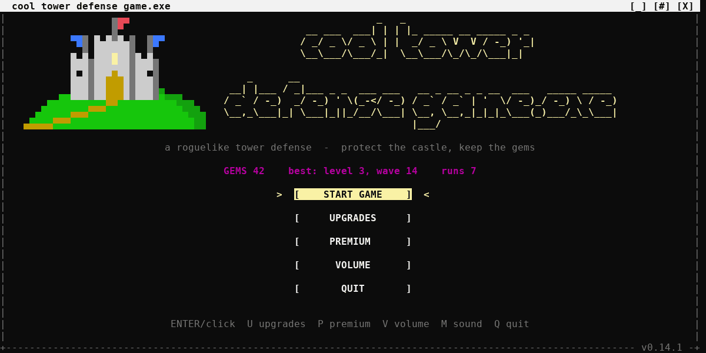
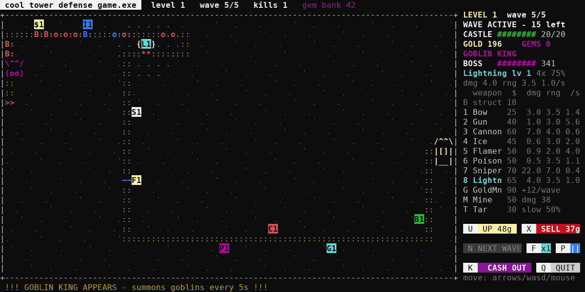

# cool tower defense game.exe

> A roguelike tower defense game that runs in your terminal, with music, voice lines and no dependencies.
> Made for the **B.A.L.L.S hackathon** by Ádám Zsidákovits and Cristian-Mihai Radu.


Enemies march down randomly generated paths toward your castle. Build structures, mount one of 8 weapons
on them, lay traps, and survive as long as you can. Every level is 5 waves and ends with one of
**5 big bosses**, and every new level opens **one more path** to your castle. When the castle falls you
keep your **gems** and spend them on permanent upgrades for the next run.

**Main menu**: a pixel-art castle on a green hill sits next to the title, with the enemy path winding up to its gate.



**In a run:** level 1's boss, the Goblin King, has just arrived. All 8 weapons, a gold mine `$1`, a mine `**`
and tar `~~` are on the map. The side panel shows the boss bar, every weapon's stats and the buttons: click them
or press the letter on the key cap. A greyed-out button can't be used right now (here: NEXT WAVE, because a
wave is running).



## Table of contents

- [Features](#features)
- [Getting started](#getting-started)
- [How to play](#how-to-play)
- [Controls](#controls)
- [Game reference](#game-reference)
- [Music and sound](#music-and-sound)
- [Tuning the game](#tuning-the-game)
- [Project structure](#project-structure)
- [How the code works](#how-the-code-works)
- [Project history](#project-history)
- [Contributing](#contributing)
- [Roadmap](#roadmap)
- [Authors](#authors)
- [License](#license)

## Features

- **Roguelike runs.** Every run has a new random map, and after every wave you choose 1 of 3 random blessings.
- **Levels that grow.** A level is 5 waves, and each new level adds another enemy path to your castle.
- **5 big bosses.** One ends every level: Goblin King, Iron Golem, Swamp Hydra, Shadow Wraith and Bone Dragon,
  each with its own ability. After the 5th they come back stronger (*II*, *III*, …).
- **8 weapons.** Build a structure, then mount a Bow, Gun, Cannon, Ice, Flamer, Poison, Sniper or Lightning
  tower on it. Upgrade it up to level 5. The side panel shows every weapon's live stats.
- **Economy and traps.** Gold Mines earn gold after every wave, and each one you own makes the next 50% dearer.
  Mines explode on the path, and Tar slows enemies.
- **Meta progression.** Gems survive death and buy permanent upgrades and weapon unlocks.
- **Cash out on purpose.** Blow up your own castle to keep your gems and turn leftover gold into bonus gems.
- **Music and voice.** A menu theme and a theme for each of the 5 levels, all looping seamlessly. Grunts,
  runners and brutes each have a voiced death sound, every level from 1 to 5 has a "level complete" voice
  line, and a special thanks from the creator plays when you reach level 6. Music, death sounds and the
  announcer each have their own volume slider.
- **Full-screen layout.** The map takes every column of your terminal except a slim 24-column side panel.
  You can play with the keyboard or the mouse.
- **Real buttons.** The side panel has coloured buttons for upgrade, sell, next wave, speed, pause, cash out
  and quit. Each shows its key on a white key cap; click it or press the key. It lights up when pressed and
  is greyed out when it can't be used.
- **Retro menu.** A window-style main menu with START GAME, UPGRADES, PREMIUM, VOLUME and QUIT buttons, and a
  pixel-art castle on a hill next to the title, built from terminal block characters.
- **Premium store (preview).** A real-money shop for a Nuke, gem packs and more. Payments aren't connected yet,
  so nothing can actually be bought.
- **Zero dependencies.** One Python file using only the standard library. The music and sound play with
  what your OS already has.

## Getting started

### Requirements

- Python **3.8+**
- A terminal of at least **70×22** characters. Bigger is better: the map fills the window next to the side
  panel (80 columns gives a 26-tile-wide map, 200 columns gives 86).
- The castle next to the menu title needs a window at least **105 columns** wide and a UTF-8 terminal (every
  modern terminal, including Windows Terminal). From **138 columns** the title is exactly centred with the
  castle right beside it. In narrower windows the title moves right just enough to make room for the castle,
  and below 105 columns the menu shows only the title.
- Windows only: `pip install windows-curses`
- Sound: nothing to install on Windows, macOS or most Linux systems (see [How the sound plays](#how-the-sound-plays)).

### Install and run

```bash
git clone https://github.com/zsidiadi/Ball-Heckaton-ascii-game.git
cd Ball-Heckaton-ascii-game
python3 "cool tower defense game.exe.py"          # macOS / Linux (or: ./"cool tower defense game.exe.py")
py "cool tower defense game.exe.py"               # Windows (or double-click the file)
python3 "cool tower defense game.exe.py" --mute   # no music or sound effects
```

> The file is a normal Python script: `cool tower defense game.exe` is the game's name and `.py` is its format.
> Keep the quotes around the name in the terminal, since it has spaces. On Windows you can also double-click it
> if Python is installed.

> **Tip:** maximise or full-screen the terminal **before** starting a run. The map size is fixed
> when the run begins.

## How to play

1. **Build.** Move the cursor onto a grass tile and press **B** to build a structure `[]` (10 gold).
2. **Arm it.** Press **1–8** to mount a weapon on that structure. The side panel shows each weapon's
   cost, damage, range and shots per second.
3. **Economy and traps (optional).** Press **G** on grass for a Gold Mine. On the enemy path `::`,
   press **M** for a Mine or **T** for Tar. None of these need a structure.
4. **Fight.** Press **N** to send the next wave. Kills give gold.
5. **Choose a blessing.** After each wave, pick 1 of 3 random bonuses.
6. **Beat the boss.** Wave 5 of every level ends with a big boss. Its name and HP bar appear in the side panel.
7. **Level up.** Clear all 5 waves and you get a reward plus a voice line. The next level opens a new path,
   which blinks red. If the new path runs over a tower, you get that tower's full cost back.
8. **Lose well.** When the castle falls you keep the run's gems. Press **K** at any time to blow up the
   castle yourself; every 25 leftover gold becomes 1 extra gem. Quitting with **Q** forfeits the run's gems.
9. **Upgrade.** Open **UPGRADES** in the main menu, spend your gems, then start a stronger run.

## Controls

### Menus

| Key | Action |
| --- | --- |
| Up / Down (or `w` / `s`) | Move between buttons / items |
| `Enter` / `Space` | Press the selected button / buy the selected item |
| `U` | Open the Upgrades screen |
| `P` | Open the Premium store |
| `V` | Open the Volume screen |
| Left / Right (or `a` / `d`, `-` / `+`) | Volume screen: turn the selected slider down / up |
| `M` | All sound (music, effects, voice) on / off, saved. You can also click `[M] sound` in the bottom-left corner |
| `1`–`9`, `0` | Upgrades screen: quick-buy one of the first ten upgrades |
| `1`–`6` | Premium store: pick an item to buy (opens the confirm dialog) |
| `Y` / `N` | Premium store: confirm / cancel a purchase |
| `Esc` / `Backspace` / `B` | Back to the main menu |
| `Q` | Quit (main menu) |
| Mouse click | Any button, upgrade row or `[ BUY ]`. `[X]` in the title bar closes the screen |

### In a run

| Key | Action |
| --- | --- |
| Arrow keys / `w` `a` `s` `d` | Move cursor |
| `W` `A` `S` `D` (Shift) | Move cursor 5 tiles |
| Mouse click | Move cursor to the clicked tile, or press a side-panel button |
| `B` | Build structure |
| `1`–`8` | Mount Bow / Gun / Cannon / Ice / Flamer / Poison / Sniper / Lightning |
| `G` | Place a Gold Mine (grass) |
| `M` | Place a Mine (enemy path) |
| `T` | Place Tar (enemy path) |
| `U` | Upgrade weapon or Gold Mine (button **UP**, shows the price) |
| `X` | Sell (50% refund); also removes Mines and Tar (button **SELL**, shows the refund) |
| `N` | Start next wave (button **NEXT WAVE**) |
| `F` | Game speed x1 / x2 / x3 (button shows the current speed) |
| `P` | Pause / resume (button `\|\|`, `>` while paused) |
| `K` | Destroy your own castle (button **CASH OUT**) |
| `Q` | Quit run, gems lost (button **QUIT**) |
| `Enter` | Continue (level complete, game over) |

## Game reference

### Weapons

| Key | Weapon | Map | Cost | Damage | Range | Shots/s | Special | Unlock |
| --- | --- | --- | --- | --- | --- | --- | --- | --- |
| 1 | Bow | `B` | 25g | 3.0 | 3.5 | 1.4 | steady single target | free |
| 2 | Gun | `G` | 40g | 1.0 | 3.0 | 5.6 | very high fire rate | free |
| 3 | Cannon | `C` | 60g | 7.0 | 4.0 | 0.6 | splash radius 1.3 | 8 gems |
| 4 | Ice | `I` | 45g | 0.6 | 3.0 | 2.0 | halves enemy speed for 1.2 s | 10 gems |
| 5 | Flamer | `F` | 50g | 0.9 | 2.0 | 4.0 | burns **every** enemy in range | 6 gems |
| 6 | Poison | `P` | 50g | 0.5 | 3.5 | 1.1 | poison: 2 dmg/s for 3 s, **ignores armor** | 10 gems |
| 7 | Sniper | `S` | 70g | 22.0 | 7.0 | 0.4 | huge range, shoots the enemy with the **most HP** | 12 gems |
| 8 | Lightning | `L` | 65g | 4.0 | 3.5 | 1.0 | chains to 4 enemies; each jump deals **75%** of the previous hit (100% → 75% → 56% → 42%), +1 jump every 2 levels | 15 gems |

- Each upgrade level gives +40% damage, +0.3 range and fires 8% faster, up to level 5. An upgrade costs
  75% of the weapon's base price × its current level. On the map a tower shows the first letter of its weapon's name and its level: `B2` is a level-2 Bow,
  `I1` a level-1 Ice. (A brute enemy is also `B`, but it walks on the path as a red `B:`; towers are coloured
  blocks on grass.)
- Locked weapons are unlocked permanently with gems on the Upgrades screen, or for one run with the
  **Armory** blessing.
- Hovering a tower shows its range on the map and its current stats in the side panel.

### Buildings and traps

Placed directly with one key (no structure needed). All of them are gem unlocks.

| Key | Item | Map | Where | Cost | Effect | Unlock |
| --- | --- | --- | --- | --- | --- | --- |
| G | Gold Mine | `$1` | any empty grass tile | 60g, +50% for each one you own (60, 90, 135, 203, …) | +12 gold after every wave (+8 per upgrade level, max level 5). Deals no damage. Upgrades cost the same for every mine (45g, 90g, …), and selling one refunds half of what it cost and makes the next one cheaper again | 8 gems |
| M | Mine | `**` | on the enemy path | 50g | explodes once when an enemy steps on it, damaging every enemy within 1.5 tiles. Then it's gone. 24 dmg on wave 1, +12.5% per wave (half as fast as enemy HP grows) | 6 gems |
| T | Tar | `~~` | on the enemy path | 30g | enemies on it move at half speed. Deals no damage and lasts forever (the Shadow Wraith ignores it) | 5 gems |

Only one Mine or Tar fits on each path tile. `X` removes it for half its price.

### Enemies

| Map | Enemy | Base HP | Speed | Castle damage | Gold | Appears |
| --- | --- | --- | --- | --- | --- | --- |
| `o` | Grunt | 8 | 1.5 | 1 | 3 | always |
| `r` | Runner | 5 | 2.8 | 1 | 3 | from wave 2 |
| `B` | Brute | 32 | 0.85 | 3 | 8 | from wave 4 (10% chance to drop a gem) |

Enemy HP grows ×1.25 every wave. The mark after an enemy's letter shows its health:
`:` means healthy, `.` means hurt, and nothing means almost dead. A slowed enemy turns blue,
and a poisoned one turns magenta.

### Bosses

One big boss closes every level: it's the last enemy of wave 5, 10, 15, … Bosses are drawn 2 rows tall,
are announced when they appear, and get a name and HP bar in the side panel.

| Level | Boss | Sprite | Base HP | Speed | Castle damage | Reward | Ability |
| --- | --- | --- | --- | --- | --- | --- | --- |
| 1 | Goblin King | `\^^/` `(oo)` | 140 | 0.60 | 10 | 40g, 3 gems | summons 2 goblins every 5 s |
| 2 | Iron Golem | `[##]` `/\|\|\` | 150 | 0.45 | 12 | 50g, 4 gems | armor: every hit loses 3 + 0.2×wave damage (min 20% gets through). Poison ignores it |
| 3 | Swamp Hydra | `~@@~` `\HH/` | 170 | 0.55 | 14 | 60g, 5 gems | regenerates 1.5% of max HP per second |
| 4 | Shadow Wraith | `(..)` `/~~\` | 130 | 0.70 | 16 | 70g, 6 gems | can't be slowed, teleports 4 tiles forward every 4 s |
| 5 | Bone Dragon | `/\/\` `<DD>` | 220 | 0.55 | 20 | 100g, 8 gems | enrages below 50% HP: double speed |
| 6+ | the same five again | | | | | | named *II*, *III*, … with HP for that wave |

### Levels and rewards

| Level | Waves | Open paths | New path starts at |
| --- | --- | --- | --- |
| 1 | 1–5 | 1 | west `>>` |
| 2 | 6–10 | 2 | north `vv` |
| 3 | 11–15 | 3 | south `^^` |
| 4+ | … | +1 per level | west, north, south, … |

| Reward | Amount |
| --- | --- |
| Wave cleared | 8 + 2×wave gold + Gold Mine income, 1 gem (+1 more for every 10 waves) |
| Level complete | 40 + 20×level gold, 2×level gems, castle repaired by up to 25% of max HP |

### Blessings (pick 1 of 3 after each wave)

| Blessing | Effect | | Blessing | Effect |
| --- | --- | --- | --- | --- |
| Gold Rush | +40 gold right now | | Overcharge | Lightning +2 jumps |
| Mason | repair castle +15, max HP +5 | | Armory | unlock a random locked weapon or building for this run |
| Fletcher | Bows +30% damage | | Eagle Eye | all weapons +0.5 range |
| Gunsmith | Guns fire 25% faster | | Heavy Mud | new enemies move 10% slower |
| Black Powder | Cannons +30% damage, bigger blast | | Bounty | +1 gold per kill |
| Deep Freeze | Ice +50% damage, slows longer | | Cheap Bricks | structures cost half |
| Pyromaniac | Flamers +40% damage | | Gem Shard | +2 gems right now |
| Toxicology | Poison +50% damage | | Whetstone | all weapons +10% damage |
| Deadeye | Snipers +35% damage | | Haggler | a random weapon costs half from now on, its upgrades too |
| Royal Gift | your next weapon or building is free | | | |

Blessings for weapons you haven't unlocked never show up.

- **Haggler** picks one of the weapons you can use in this run that isn't half price yet. Each weapon can
  only be halved once (25g → 12g, upgrades 18g → 9g, …). Gold Mines, Mines and Tar are never halved. Once
  every usable weapon is half price, Haggler stops showing up.
- **Royal Gift** makes the next weapon you mount or the next building you place (Gold Mine, Mine, Tar) cost
  nothing. Structures and upgrades don't use it up. After that, prices are back to normal. While a gift is
  waiting, the side panel says `FREE x1` and shows every price as 0. Taking it twice gives two free ones. A free
  item refunds nothing when sold, and a free Gold Mine still counts toward the next Gold Mine's price.

### Upgrades (permanent, bought with gems)

All upgrades live behind the **UPGRADES** button in the main menu.

| Upgrade | Effect per level | Max | Cost |
| --- | --- | --- | --- |
| Thick Walls | +10 castle HP (base 20) | 10 | 3 × next level |
| War Chest | +20 starting gold (base 60) | 10 | 3 × next level |
| Sharpened Steel | +10% weapon damage | 10 | 4 × next level |
| Gem Magnet | +25% gems earned | 5 | 5 × next level |
| Unlock Tar | Tar can be placed | 1 | 5 |
| Unlock Flamer | Flamer can be built | 1 | 6 |
| Unlock Mine | Mines can be placed | 1 | 6 |
| Unlock Cannon | Cannon can be built | 1 | 8 |
| Unlock Gold Mine | Gold Mines can be placed | 1 | 8 |
| Unlock Ice | Ice can be built | 1 | 10 |
| Unlock Poison | Poison can be built | 1 | 10 |
| Unlock Sniper | Sniper can be built | 1 | 12 |
| Unlock Lightning | Lightning can be built | 1 | 15 |

Progress (gems, upgrades, best level and wave, sound on/off and volumes) is saved in `keep_save.json` next to the game file
(it kept its old name so nobody loses their progress).
Delete that file to reset.

### Premium store (preview: payments not connected)

The **PREMIUM** button in the main menu opens a real-money store. Right now it's only a preview:
choosing an item and confirming shows *"Payments aren't connected yet - nothing was charged"*.
**No money is taken and nothing is given**, and the items don't do anything in the game yet.

| Item | Price | What it will do |
| --- | --- | --- |
| Nuke | EUR 5.00 | kills every enemy on the field (one use) |
| 10 Gems | EUR 5.00 | +10 gems to spend on Upgrades |
| Second Chance | EUR 3.00 | your castle survives one deadly hit per run |
| Gem Doubler | EUR 8.00 | earn 2x gems from every run, forever |
| Unlock All | EUR 10.00 | every weapon and building unlocked at once |
| Golden Castle | EUR 2.00 | a shiny golden castle (cosmetic only) |

Prices are shown as `EUR` instead of `€` because the euro sign doesn't display in every terminal.
To sell these for real, the game needs a payment provider (for example Stripe). Then set
`PAYMENTS_ENABLED = True` and grant the item in `App.purchase()` after a successful payment.

## Music and sound

`M` in the main menu (or `--mute` on the command line) turns all of it on or off.

### Music

Every screen has its own seamless loop:

| When | Track | File |
| --- | --- | --- |
| Main menu, Upgrades, Premium | menu theme | `assets/menu_loop.wav` |
| Level 1 … 5 | that level's theme | `assets/level1_loop.wav` … `level5_loop.wav` |
| Level 6, 7, … | Level 1, 2, … again (like the bosses) | |
| LEVEL COMPLETE screen (levels 1-5) | silence, so the voice line is heard | |

The menu theme keeps playing while you move between menu screens. When a run starts, the level's track
takes over and switches when you start the next level. Back in the menu, the menu theme returns.

**Seamless loops.** Every original track (`assets/source/`) is exactly 16 bars at 132 BPM, so its length is a
perfect loop, but the ends weren't made to loop. Some faded to near-silence in the last ~45 ms (a dropout at
every repeat), and others ended far from where they start (a click). `tools/make_loops.py` fixes each one:
the last 75 ms are replaced by the track's own lead-in to a bar that sounds like bar 1 (bar 11 for the menu
and Level 5, bar 5 for Levels 1-4), and the first 25 ms are blended so the last sample runs straight into the
first. Blends are loudness-preserving, and the length is unchanged, so the beat stays on time. At every loop
point the volume stays within 2.4 dB of the track's own bar transitions (the unfixed files were off by up to 12 dB).

### Sound effects and voice lines

| When | Sound | File |
| --- | --- | --- |
| a grunt `o` dies | grunt death shout | `assets/sfx/grunt_death.wav` |
| a runner `r` dies | runner death shout | `assets/sfx/runner_death.wav` |
| a brute `B` dies | brute death shout | `assets/sfx/brute_death.wav` |
| the LEVEL 1 … 5 COMPLETE screen appears | "Level N complete" | `assets/voice/level1_complete.wav` … `level5_complete.wav` |
| a player starts **level 6** (once per run) | special thanks from the creator | `assets/special/special_thanks_from_the_creator.wav` |

- Death sounds play once per death, on top of the music. Several enemies of the same kind dying in the same
  instant (a cannon blast, a mine) give one shout instead of a pile of copies, and at most 4 effects play at once.
  Bosses and enemies that reach the castle make no death sound.
- On a Level Complete screen the music pauses so the voice line plays on its own. Levels 6+ have no voice
  line, so their music keeps going.
- When level 6 starts, the special thanks plays first and level 6's music begins as soon as it ends.
  It is its own asset (`assets/special/`, constant `SPECIAL_THANKS`).
- Quitting to the menu stops any voice line that is still speaking.
- `tools/make_sfx.py` makes all of these from the recordings in `assets/source/`. Each death recording has three
  takes: Grunt and Runner use take 2 and Brute uses take 3, and you can change this in its `SOUNDS` table. Voice
  lines keep the whole recording from the first to the last spoken word. Every sound is trimmed, de-clicked and
  loudness-matched.

### Volume

The **VOLUME** button in the main menu (or `V`) opens three sliders, from 0 to 100% in steps of 10:

```
  cool tower defense game.exe - Volume                             [_] [#] [X]
|                                                                             |
|                                                                             |
|                                                                             |
|                                                                             |
|                             -=  V O L U M E  =-                             |
|                        all sound: ON   (M to switch)                        |
|                                                                             |
|             > Music         [##############------]  70%  [-] [+]            |
|                                                                             |
|               Death sounds  [##################--]  90%  [-] [+]            |
|                                                                             |
|               Announcer     [####################] 100%  [-] [+]            |
|                                                                             |
|              changing Death sounds or Announcer plays a sample              |
|                                                                             |
|                                 [   BACK   ]                                |
|                                                                             |
|           up/down choose  left/right change  M mute all  ESC back           |
|                                                                             |
|                                                                             |
|                                                                             |
|                                                                             |
+- [M] sound: ON --------------------------------------------------- v0.12.0 -+
```

| Slider | Controls |
| --- | --- |
| Music | the menu theme and the level themes. It changes live while the menu theme plays |
| Death sounds | the grunt, runner and brute death shouts. Changing it plays a grunt so you can hear the level |
| Announcer | the "level complete" lines and the special thanks. Changing it plays the level 1 line |

- Use up/down to pick a slider and left/right to change it, or click: a segment of the bar sets that level,
  `[-]` / `[+]` step it, and clicking the bar's left edge `[` mutes that slider. `M` still switches all sound off or on.
- The volumes are saved and come back the next time you play.
- Each step sounds about equally bigger: the gain is (level / 100%)², so 50% is a quarter of the amplitude
  (about -12 dB).
- pygame changes volume natively, and the Linux players get the music stream scaled as it's sent (no restart).
  Players that can't change volume themselves (Windows `winsound`, macOS `afplay`) play quieter copies of the
  sounds, made on demand in a temporary folder that is deleted when the game closes.

### How the sound plays

The `Music` class uses the first player it finds:

| Player | Where | Music | Effects and voice |
| --- | --- | --- | --- |
| `pygame` (if installed) | any OS | seamless | mixed on spare channels |
| `winsound` + MCI | Windows, built in | seamless | through Windows MCI, mixed with the music |
| `paplay` / `aplay` / `sox` | Linux (usually preinstalled); `sox` also on macOS via Homebrew | seamless (streamed without pauses) | a short player per sound |
| `afplay` | macOS, built in | a tiny restart gap once every ~5 minutes | a short player per sound |

If none of these exist, the game just stays silent. For a perfect loop on macOS, run
`pip install pygame` or `brew install sox`.

## Tuning the game

All balance numbers live at the top of `cool tower defense game.exe.py`:

| Constant | What it controls |
| --- | --- |
| `WEAPONS` | cost, damage, range, cooldown, specials and gem unlock price of each weapon |
| `BUILDINGS` | Gold Mine income and price growth per mine owned (`cost_growth`), Mine damage/growth per wave/radius, costs and unlock prices of the placeables |
| `ENEMIES` | HP, speed, castle damage and gold of each normal enemy |
| `BOSSES` | name, sprite, HP, speed, damage, rewards and ability of the 5 bosses |
| `HP_GROWTH` | how fast enemies get tougher each wave (default `1.25`) |
| `WAVES_PER_LEVEL` | waves per level (default `5`) |
| `STRUCT_COST`, `MAX_LEVEL` | structure price, max weapon level |
| `META_UPGRADES` | items and prices on the Upgrades screen |
| `PERKS` | the blessing pool |
| `EDGES` | the order in which new paths enter the map |
| `PREMIUM`, `PAYMENTS_ENABLED` | premium store items and euro prices; payments switch (off) |
| `MUSIC_DIR`, `MENU_TRACK`, `LEVEL_TRACKS`, `MENU_STATES` | where the audio lives, which track plays on the menu screens and in each level |
| `DEATH_SOUNDS`, `SFX_MAX_AT_ONCE`, `SFX_MIN_GAP` | each enemy's death sound, and how many effects may overlap |
| `VOLUME_SLIDERS`, `volume_gain()` | the sliders on the Volume screen and how a slider level turns into loudness |
| `LEVEL_COMPLETE_SOUNDS`, `SPECIAL_THANKS`, `SPECIAL_THANKS_LEVEL` | the Level Complete voice lines; the creator's thanks and the level that triggers it |
| `GAME_NAME`, `VERSION` | the name and version shown in the menu and title bar |
| `PANEL_BUTTONS`, `BUTTON_ROWS`, `BTN_FLASH` | the side-panel buttons: colour of each, how they're grouped into rows, how long one lights up when pressed |
| `MENU_CASTLE`, `ART_COLORS`, `ART_GAP` | the castle beside the menu title: pixel rows (one letter per pixel), the colour of each letter, and the gap between castle and title |
| `MIN_W`, `MIN_H`, `PANEL_W` | minimum terminal size and width of the side panel (24) |
| `MAX_MAP_W`, `MAX_MAP_H` | largest map size in tiles (default 150×70) |

## Project structure

```
.
├── cool tower defense game.exe.py # the whole game: one Python file, standard library only
├── assets/
│   ├── menu_loop.wav              # seamless music loops (made by tools/make_loops.py)
│   ├── level1_loop.wav … level5_loop.wav
│   ├── sfx/                       # grunt_death.wav, runner_death.wav, brute_death.wav
│   ├── voice/                     # level1_complete.wav … level5_complete.wav
│   ├── special/                   # special_thanks_from_the_creator.wav
│   └── source/                    # originals: music .ogg files and all .m4a voice recordings
├── docs/
│   ├── menu.png                   # main menu screenshot used in this README
│   └── game.png                   # in-game screenshot used in this README
├── tools/
│   ├── make_loops.py              # rebuilds the music loops from the originals (numpy + ffmpeg)
│   └── make_sfx.py                # makes the death sounds and voice lines from the recordings (numpy + ffmpeg)
├── README.md                      # this file
├── CHANGELOG.md                   # version history: what changed and when
├── .gitignore                     # ignores __pycache__ and the save file
└── keep_save.json                 # created on first run (git-ignored)
```

## How the code works

`cool tower defense game.exe.py` is organised top to bottom as follows:

| Section | Responsibility |
| --- | --- |
| Constants | balance and content data (`WEAPONS`, `BUILDINGS`, `ENEMIES`, `BOSSES`, `META_UPGRADES`, `PERKS`, `PREMIUM`, sound tables, …) |
| `Music` | all audio: picks a player (pygame, winsound + MCI, paplay/aplay/sox, afplay), loops a track (`play`), switches tracks, plays one-shot sounds on top (`effect`), stops them (`stop_effects`), and sets the volume of music, death sounds and announcer (`set_volume`) |
| `load_meta` / `save_meta` | read and write the JSON save file |
| `Enemy` | an enemy walking along **its own path** (`pos` = how many cells it has walked). Bosses carry their ability state (armor, timer, enraged) |
| `Tower` | a structure, weapon or Gold Mine on a tile (`kind`, `level`, `invested`) |
| `Run` | one playthrough: map, paths, towers, traps, enemies, waves, levels, the run state machine, and sound cues in `Run.events` |
| `App` | main menu, Upgrades screen, Premium store, clickable buttons, input and mouse, music choice (`sync_music`), sound cues (`play_cues`), and **all drawing** |
| `main()` | curses setup, colours, then a fixed **30 FPS** loop: input → update → draw |

**Run state machine**

```
build ──N──▶ wave ──all enemies gone──▶ perk ──1/2/3──▶ build
                │                         │
                │ castle HP = 0           └─ after wave 5, 10, 15… ──▶ levelup ──Enter──▶ build (+1 path)
                ▼
              over ◀──Y── confirm ◀──K/Q── (any playing state)
```

**Path generation** (`place_castle`, `gen_path`, `score_path`, `add_path`): the castle sits on the right edge
with several entry tiles around it. Each new path starts on the next map edge (west, then north, then south).
It is built from random waypoints joined by straight segments, and any loops are cut out. The generator makes
250 candidate paths and scores each one. It avoids paths that run over towers, overlap other paths, touch
themselves or run alongside other paths, and it prefers paths of a good length. The best-scoring candidate wins.

**Combat** (`update`, `fire`, `hit`, `boss_ability`): every frame, each weapon whose cooldown is ready looks at
the enemies in range. Most weapons target the enemy with the fewest tiles left to the castle, the Sniper
targets the one with the most HP, and the Flamer hits all of them. Cannons damage everything in their splash
radius, Ice slows, Poison applies damage over time, and Lightning chains to nearby enemies (each jump
multiplies the damage by `falloff`, 0.75). All direct hits go through `hit()`, which applies boss armor.
Poison damage skips it.

**Prices** (`Run.price`, `pay`, `upgrade_cost`, `building_cost`): everything that puts a weapon or building
down asks `price(kind)`. That's 0 while a Royal Gift is waiting, half for a Haggler weapon, and grows with
every Gold Mine you own. `pay` takes the gold and uses up the gift. A tower's `invested` is what was really
paid, so selling always refunds half of that.

**Buildings and traps** (`place_building`, `explode`, `income`): Gold Mines live in `Run.towers` next to the
weapons (they can be upgraded and sold) and pay out in `wave_cleared()`. Mines and Tar live in `Run.traps`, a
map of path tiles. Each frame, enemies standing on Tar get slowed, and any Mine with an enemy on its tile
calls `explode()`.

**Side-panel buttons** (`PANEL_BUTTONS`, `App.button_specs`, `button_row`, `button_attrs`, `run_key`): each
frame, `button_specs` works out every button's label and whether it can be used right now (from the run's
state and the tile under the cursor). `button_row` lays a row out across the panel's 24 columns, as a
` K ` key cap followed by the coloured label. Each button is also registered as a clickable zone. A click
goes through `run_key`, exactly like pressing the key, and lights the button up for `BTN_FLASH` seconds.
On short terminals the panel drops rows in a fixed order (see `draw_panel`): hints first, then the gaps
between buttons. The upgrade/sell and next wave/speed/pause rows never drop.

**Menu art** (`MENU_CASTLE`, `art_cells`, `init_art_colors`, `App.draw_art`): the castle beside the title is
pixel art stored as rows of letters, one letter per pixel. `art_cells` packs two pixel rows into one terminal
row with the half blocks `▀` `▄` and the full block `█`. A cell whose two pixels differ uses the background
colour for the lower one. `init_art_colors` makes a colour pair for each combination (13 in total) and
uses the bright colours directly on 16-colour terminals or through bold on 8-colour ones. The castle
is only drawn when the window has room for it and the terminal can show block characters.

**Sound cues** (`Run.events` → `App.play_cues`): the game logic never touches audio. It only records cues,
`("death", kind)`, `("level_complete", n)` and `("level_start", n)`, and the App turns them into sounds once
per frame. `App.sync_music()` picks the track for the current screen, or silence.

## Project history

Full details are in [CHANGELOG.md](CHANGELOG.md). Each version is tagged in Git, so
`git diff v0.1.0 v0.2.0` shows exactly what changed.

| Version | Date | Commit | Highlights | game file size |
| --- | --- | --- | --- | --- |
| 0.0.0 | 2026-10-12 | `f9ef6a2` | Repository created | — |
| [0.1.0](CHANGELOG.md#010---2026-10-12) | 2026-10-12 | `d2ddb55` | First playable tower defense: weapons, waves, blessings, gems, gem shop | 834 lines |
| [0.2.0](CHANGELOG.md#020---2026-10-12) | 2026-10-12 | `cc20d54` | Full-screen map, 5-wave levels, +1 enemy path per level, mouse support | 1037 lines |
| [0.3.0](CHANGELOG.md#030---2026-10-12) | 2026-10-12 | `e973e43` | Renamed to *cool tower defense game.exe*, full-width map with HUD below, menu buttons + Upgrades screen, standard README and CHANGELOG | 1218 lines |
| [0.4.0](CHANGELOG.md#040---2026-10-12) | 2026-10-12 | `b3344c7` | Side panel back on the right, 8 weapons with live stats, 5 big bosses, trees and flowers | 1425 lines |
| [0.5.0](CHANGELOG.md#050---2026-10-12) | 2026-10-12 | `60add35` | Trees and flowers removed, slimmer 24-column panel so the map is as wide as possible | 1390 lines |
| [0.6.0](CHANGELOG.md#060---2026-10-12) | 2026-10-12 | `4468936` | Lightning tower (replaces Tesla), Gold Mine, Mine and Tar as gem unlocks | 1505 lines |
| [0.7.0](CHANGELOG.md#070---2026-10-12) | 2026-10-12 | `d3e9b48` | PREMIUM button + real-money store preview (Nuke, gem packs, …), payments not connected | 1617 lines |
| [0.8.0](CHANGELOG.md#080---2026-10-13) | 2026-10-13 | `aef90c3` | Seamless looping menu music (menu screens only), `M` to mute | 1798 lines |
| [0.9.0](CHANGELOG.md#090---2026-10-13) | 2026-10-13 | `5d878c2` | Level 1-5 music (seamless loops), track switching per level | 1847 lines |
| [0.10.0](CHANGELOG.md#0100---2026-10-13) | 2026-10-13 | `45fc505` | Death sounds for grunts, runners and brutes | 1920 lines |
| [0.11.0](CHANGELOG.md#0110---2026-10-13) | 2026-10-13 | `f23ef8f` | Level complete voice lines (1-5), special thanks at level 6 | 1980 lines |
| [0.12.0](CHANGELOG.md#0120---2026-10-13) | 2026-10-13 | `8d963d9` | VOLUME screen: separate sliders for music, death sounds and announcer; README refresh | 2148 lines |
| [0.13.0](CHANGELOG.md#0130---2026-10-13) | 2026-10-13 | `80fc4ec` | Game file renamed from `keep.py` to `cool tower defense game.exe` | 2150 lines |
| [0.13.1](CHANGELOG.md#0131---2026-10-13) | 2026-10-13 | `26f9e2f` | Game file is `cool tower defense game.exe.py`: the game's name, still a `.py` file | 2149 lines |
| [0.14.0](CHANGELOG.md#0140---2026-10-13) | 2026-10-13 | `a773bc8` | Pixel-art castle on a hill next to the title on the main menu | 2277 lines |
| [0.14.1](CHANGELOG.md#0141---2026-10-13) | 2026-10-13 | `ab53c85` | Castle and title moved a bit to the left | 2279 lines |
| [0.15.0](CHANGELOG.md#0150---2026-10-13) | 2026-10-13 | `8e1e4ae` | Coloured, clickable buttons in the side panel | 2392 lines |
| [0.15.1](CHANGELOG.md#0151---2026-10-13) | 2026-10-13 | `f7c08a8` | Menu title centred again, castle right next to it | 2393 lines |
| [0.16.0](CHANGELOG.md#0160---2026-10-13) | 2026-10-13 | `626a1c8` | Balance: Mine costs 50 (was 25), its damage grows half as fast | 2394 lines |
| [0.17.0](CHANGELOG.md#0170---2026-10-13) | 2026-10-13 | `1856752` | Balance: each Gold Mine you own makes the next one 50% more expensive | 2406 lines |
| [0.18.0](CHANGELOG.md#0180---2026-10-13) | 2026-10-13 | `e67d9ac` | Frost renamed to Ice; towers show their weapon's first letter on the map | 2409 lines |
| [0.19.0](CHANGELOG.md#0190---2026-10-13) | 2026-10-13 | tag `v0.19.0` | New blessings: Haggler (a random weapon costs half) and Royal Gift (next one is free) | 2455 lines |

## Contributing

- **Branches:** `main` is the stable, playable version. Try new things on `test` (or a feature
  branch) and merge into `main` once it works.
- **Changelog:** every change that players or developers would notice gets a line under
  `## [Unreleased]` in [CHANGELOG.md](CHANGELOG.md), grouped as *Added*, *Changed*, *Fixed* or *Removed*.
- **Releases:** when you release, rename `Unreleased` to the new version and date, bump `VERSION` in
  `cool tower defense game.exe.py` and the version badge in this README, and tag the commit:
  ```bash
  git tag -a v0.12.0 -m "v0.12.0"
  git push origin v0.12.0
  ```
  Versions follow [SemVer](https://semver.org/): new features bump the minor version (0.**12**.0),
  and fixes bump the patch version (0.12.**1**).
- **Audio:** put new recordings in `assets/source/`, add them to the table in `tools/make_loops.py` (music) or
  `tools/make_sfx.py` (effects and voice), and run the script. Both need `numpy` and `ffmpeg`.
- **Commits:** use short imperative summaries, e.g. `Add flying enemies` or `Fix cursor on small terminals`.
- **Before pushing:** run `python3 -m py_compile "cool tower defense game.exe.py"`, then play at least one wave.

## Roadmap

These are ideas, not promises:

- [ ] Flying enemies that ignore the path
- [ ] Sound effects for weapons and bosses
- [ ] An in-game mute key (in a run, `M` places mines)
- [ ] Local high-score table
- [ ] Automated smoke tests in CI
- [ ] Connect a payment provider and make the Premium items work

## Authors

- **Ádám Zsidákovits**
- **Cristian-Mihai Radu**

Built for the B.A.L.L.S hackathon, with AI pair-programming help from Claude.

## License

No license has been chosen yet, so all rights are reserved by the authors.
To let others reuse the code, add a `LICENSE` file (for example MIT).
